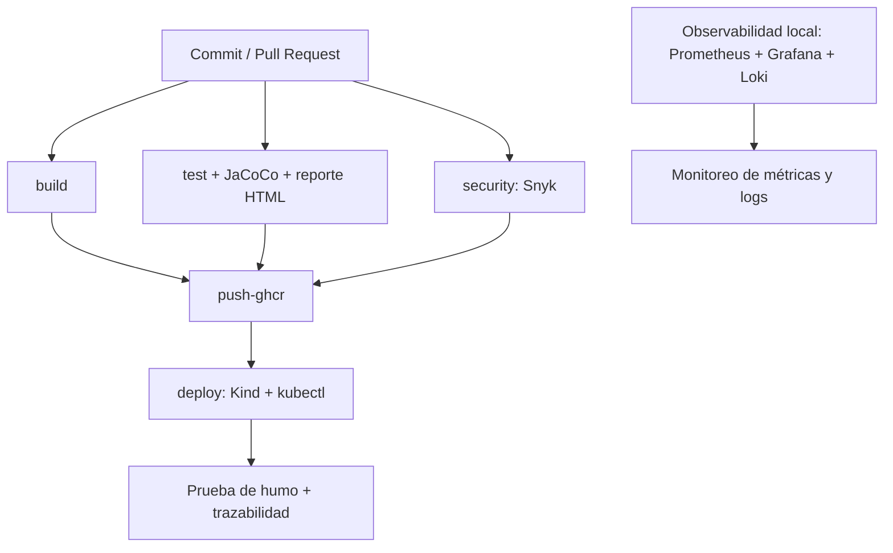

# devops_007d_ols — Pipeline DevOps para el Microservicio de Catálogo (ms-productos)

## 1. Introducción y Propósito del Proyecto

Este repositorio contiene la base del microservicio `ms-productos` (catálogo de 
productos), desarrollado previamente en Spring Boot, utilizado como base para 
implementar el pipeline DevOps del curso Ingeniería DevOps. 
El objetivo de este encargo es demostrar el uso de control de versiones colaborativo 
mediante Git y GitHub, la automatización de integración continua con 
GitHub Actions, y la ejecución del microservicio con Docker Compose.

**Integrantes:** Javier Romero (Fakiier) — Catalina Campos (miucat05)

**Stack técnico:** Java 21, Spring Boot 3.5.15, Maven, MySQL (producción) / H2 (tests), 
Spring Security con JWT, Eureka Client, Flyway, JaCoCo, Snyk, Dependabot, Docker y Docker Compose.

## 2. Estrategia de Ramificación y Justificación

Se implementó **GitFlow** como modelo de ramificación. Se eligió este modelo porque:

- El encargo requería explícitamente ramas diferenciadas para desarrollo (`develop`), 
  producción (`main`), nuevas funcionalidades (`feature/*`) y arreglos urgentes (`hotfix/*`).
- Al trabajar en pareja sobre el mismo microservicio, GitFlow nos permitió que cada uno
  desarrolle su propia trabajo en una rama independiente sin afectar el trabajo 
  del otro, integrando los cambios de forma controlada mediante pull Requests.
- Separar `main` de `develop` permitió mantener siempre una versión estable del 
  microservicio, mientras el trabajo en curso se valida en `develop` antes de integrarse.

Ramas utilizadas en este repositorio:
- `main`: versión estable del microservicio
- `develop`: rama de integración de los cambios en desarrollo
- `feature/busqueda-productos`: nuevo endpoint para verificar existencia de un producto
- `feature/<validacion-stock>`: validación de stock no negativo al crear un producto
- `hotfix/<corregir-validacion-producto>`: corrección de la validación de existencia de producto
- `feature/ajuste-dockerfile` y `feature/docker-compose`: Dockerfile y Docker Compose del microservicio
- `feature/pipeline-ep2`: pipeline de CI (pruebas, reporte HTML y publicación en ghcr.io)

## 3. Convenciones de Commits y Naming de Ramas

**Formato de mensajes de commit:**
- `feat:` nueva funcionalidad
- `fix:` corrección de errores
- `ci:` cambios de automatización
- `docs:` cambios de documentación
- `chore:` configuración del entorno

**Naming de ramas:** `feature/<nombre>` para nuevas funcionalidades y `hotfix/<nombre>` para arreglos urgentes.

## 4. Estrategia de Revisión de Pull Requests

Cada Pull Request fue revisado por el otro integrante del equipo antes de aprobar 
el merge, verificando:

- Que el pipeline de GitHub Actions (CI) pasara en verde antes de mergear.
- Que la rama base del Pull Request fuera la correcta según el tipo de cambio 
  (`develop` para features, `main` para hotfix).
- Que el código compilara sin errores y no rompiera funcionalidad existente.

Se detectó y corrigió durante el desarrollo una inconsistencia entre la ruta 
definida en el controlador (`/exist/{id}`) y la esperada por las pruebas 
(`/exists/{id}`), resuelta mediante un commit adicional de corrección.

## 5. Docker y Docker Compose

Para ejecutar el microservicio con su base de datos:

1. Crear el archivo `.env` a partir del ejemplo (el `.env` no se sube al repositorio):

   ```
   copy .env.example .env
   ```

2. Levantar los servicios:

   ```
   docker compose up --build
   ```

3. Verificar que ambos estén `healthy`:

   ```
   docker compose ps
   ```

4. Detener:

   ```
   docker compose down
   ```

La app queda en el puerto `9095` y MySQL en el `3307`. Los datos de MySQL y los logs de la 
aplicación se guardan en los volúmenes `mysql_data` y `app_logs`, así que no se pierden al hacer 
`docker compose down`.

## 6. Automatización con GitHub Actions (CI/CD)

El repositorio cuenta con un workflow en `.github/workflows/ci.yml` que se ejecuta
automáticamente con cada `push` a ramas `feature/**`, `develop` y `main`, y con cada
`pull request` hacia `develop` o `main`. Usa Java 21 (distribución Temurin) y tiene cinco jobs:

| Job | Qué hace |
|---|---|
| `build` | Descarga el código, configura Java 21 y compila el proyecto con Maven |
| `test` | Ejecuta las pruebas unitarias, verifica la cobertura mínima de JaCoCo, genera el reporte HTML y lo sube como artefacto |
| `security` | Analiza las dependencias con Snyk (`snyk test`) y el código con Snyk Code; falla si hay vulnerabilidades altas o críticas que no estén aceptadas en el archivo `.snyk` |
| `push-ghcr` | Construye la imagen Docker y la publica en ghcr.io (solo en `push` a `develop` o `main`, y solo si `build`, `test` y `security` pasan) |
| `deploy` | Descarga la imagen publicada, levanta un clúster de Kubernetes (kind) dentro del workflow, aplica los manifiestos de `k8s/` (namespace `app`, MySQL y `ms-productos`), espera a que los pods estén listos, hace una prueba de humo y registra la trazabilidad. Se ejecuta en un entorno simulado (`staging` para `develop`, `production` para `main`) |

Si alguna prueba, la cobertura mínima o el análisis de seguridad falla, no se publica ni se despliega la imagen.

**Nota sobre cobertura de código:** el proyecto incluye el plugin JaCoCo con una 
regla de cobertura mínima de 80%, en evaluaciones anteriores esto se ignoró usando un skip y simplemente teniendo aproximadamente un 48% de cobertura, para su mejor funcionamiento hemos decidido ampliar este porcentaje hasta un 81%.
### 6.1 Trazabilidad y calidad

#### Flujo del pipeline



#### Cómo se garantiza la trazabilidad

Cada cambio se puede seguir desde el commit hasta el entorno desplegado:

| Etapa | Evidencia |
|---|---|
| Código | Commit con su SHA, en una rama `feature/*`, `develop` o `main`, y Pull Request revisado por el otro integrante |
| Pipeline | Ejecución en la pestaña **Actions**, identificada por su `run_id` |
| Imagen | Publicada en ghcr.io con dos tags: el **SHA del commit** (`ghcr.io/fakiier/devops_007d_ols:<sha>`) y el nombre de la rama (`develop` o `main`) |
| Despliegue | El job `deploy` descarga la imagen **por SHA**, así que lo que se despliega es exactamente lo que construyó y validó el pipeline para ese commit |
| Registro | Al terminar el despliegue, el resumen de la ejecución (*Summary*) lista rama, commit, imagen y número de ejecución |
| Entorno | El job asigna `staging` a `develop` y `production` a `main` mediante GitHub Environments. Son entornos de ejecución del workflow: el clúster Kind se crea temporalmente y no corresponde a infraestructura persistente. |
| Pruebas | El reporte HTML queda como artefacto (`reporte-pruebas-html`) en cada ejecución |

#### Cómo se garantiza la calidad

- **Pruebas automatizadas:** 44 pruebas con JUnit 5 y Mockito se ejecutan en cada push y Pull Request. Si una falla, el job `test` falla y no se publica nada.
- **Cobertura mínima:** JaCoCo exige al menos 80% de cobertura de líneas. Si no se cumple, el job `test` falla.
- **Análisis de seguridad:** el job `security` ejecuta Snyk sobre las dependencias y sobre el código, y falla ante vulnerabilidades de severidad alta o crítica.
- **Bloqueo en cadena:** `push-ghcr` solo corre si `build`, `test` y `security` pasan, y `deploy` solo corre si `push-ghcr` termina bien. Un fallo en cualquier etapa impide que la imagen se publique o se despliegue.
- **Excepciones controladas:** las vulnerabilidades que hoy no tienen corrección sin migrar a Spring Boot 4 están documentadas una a una en el archivo `.snyk`, con su justificación y fecha de vencimiento (2026-12-31), para revisarlas antes de esa fecha.
- **Dependencias al día:** Dependabot revisa semanalmente Maven, Docker y GitHub Actions y abre Pull Requests con las actualizaciones.
- **Verificación del despliegue:** después de aplicar los manifiestos en Kubernetes, el pipeline espera con `kubectl rollout status` a que MySQL y `ms-productos` estén listos y ejecuta una prueba de humo contra la API. Si falla, el despliegue falla.
- **Control de cambios:** los cambios entran por Pull Request con el pipeline en verde y revisión del otro integrante. Los permisos del workflow están limitados a lectura, salvo la publicación de paquetes.

### 6.2 Despliegue en Kubernetes (IE2)

Los manifiestos están en la carpeta `k8s/` y se aplican en orden numérico:

| Archivo | Contenido |
|---|---|
| `00-namespace.yaml` | Namespace `app` |
| `01-config.yaml` | `ConfigMap` con la configuración del microservicio y `Secret` con la clave de MySQL |
| `02-mysql.yaml` | MySQL 8 con volumen persistente (`PersistentVolumeClaim`) y su `Service` |
| `03-app.yaml` | `Deployment` de `ms-productos` (con probes y límites de recursos) y su `Service` en el puerto 9095 |

Puntos importantes del diseño:

- El `Deployment` incluye un *init container* que espera a que MySQL acepte conexiones antes de arrancar la aplicación, porque Flyway migra la base al iniciar.
- Tiene `startupProbe`, `readinessProbe` y `livenessProbe`, y límites de CPU y memoria (`requests` 250m / 384Mi y `limits` 1 CPU / 768Mi).
- La clave de MySQL del archivo `01-config.yaml` es solo para pruebas locales. En el pipeline se genera una clave aleatoria en cada despliegue y se reemplaza antes de aplicar el manifiesto, por lo que no queda ninguna clave real en el repositorio.

**Prueba local (kind):**

```
docker build -t ms-productos:local .
kind create cluster --name devops
kind load docker-image ms-productos:local --name devops
kubectl apply -f k8s/
kubectl get pods -n app
kubectl port-forward -n app svc/ms-productos 9095:9095
```

Con el túnel abierto, `http://localhost:9095/actuator/health` debe responder `{"status":"UP"}`.

**En el pipeline:** el job `deploy` crea un clúster Kind efímero dentro de GitHub Actions, descarga la imagen publicada en GHCR identificada por el SHA del commit y despliega MySQL y `ms-productos` en el namespace `app`. También crea el namespace `monitoring`, pero el despliegue de sus componentes se omite porque todavía no existen manifiestos en `monitoring/k8s/`. Finalmente, espera a que los deployments estén listos, ejecuta una prueba de humo contra la API y registra la trazabilidad en el resumen de GitHub Actions.

Se eligió Kind porque permite validar el despliegue de Kubernetes sin contratar infraestructura externa. Cada ejecución crea su propio clúster temporal; el despliegue local realizado en el equipo se mantiene independiente.

### 6.3 Análisis de calidad con SonarQube Cloud (IE5)

El workflow `.github/workflows/sonar.yml` ejecuta las pruebas, genera el reporte de cobertura de JaCoCo y envía el análisis a SonarQube Cloud. Está configurado con `sonar.qualitygate.wait=true`, así que el job falla si el *quality gate* no se cumple.

**Limitación del plan gratuito:** SonarQube Cloud, en su plan gratuito, solo analiza la rama principal del proyecto (`main`). Por eso este workflow se ejecuta únicamente con los `push` a `main`; en las ramas `feature/*` y en los Pull Requests la calidad se controla con Snyk y con el umbral de cobertura de JaCoCo del job `test`. La condición de calidad de Sonar (por ejemplo, la calificación de seguridad del código nuevo) se evalúa cuando el trabajo llega a `main`.

**Decisión que permite tomar:** si el quality gate falla (calificación de seguridad menor a A, cobertura o duplicación fuera de umbral), el cambio no se considera listo para entrega y se corrige antes de aprobarlo. Como buena práctica de seguridad, las acciones de terceros del workflow de Sonar están fijadas por hash de commit.

### 6.4 Observabilidad: métricas, logs y alertas (IE1 e IE3)

El microservicio expone métricas con Spring Boot Actuator y Micrometer en `/actuator/prometheus` (solo se exponen `health`, `info` y `prometheus`), y escribe sus logs en formato JSON por consola. El stack de observabilidad está en la carpeta `monitoring/`:

| Herramienta | Uso |
|---|---|
| Prometheus | Recolecta cada 15 segundos las métricas de `ms-productos` y evalúa las alertas |
| Grafana | Dashboard `ms-productos.json`, cargado automáticamente (aprovisionamiento por archivos) con métricas y logs |
| Loki + Alloy | Recolectan los logs del contenedor para verlos en Grafana |

**Alertas definidas** (`monitoring/alert.rules.yml`):

| Alerta | Condición | Decisión que habilita |
|---|---|---|
| `ServicioCaido` | `up == 0` durante 1 minuto | Revisar el pod y los logs; si persiste, revertir al despliegue anterior |
| `ErroresServidorAltos` | Más del 5% de las respuestas son 5xx durante 2 minutos | Revisar los logs de errores; detener la promoción a `main` |
| `MemoriaHeapAlta` | Heap de la JVM sobre el 85% durante 5 minutos | Ajustar los límites de memoria del `Deployment` |

**Dashboard:** muestra errores 5xx por segundo, uso de CPU, memoria heap, disponibilidad y los logs del servicio. 

**Alcance del monitoreo:** el stack de observabilidad está configurado y probado localmente mediante Docker Compose, utilizando los archivos de `monitoring/`. Actualmente, el pipeline de GitHub Actions no despliega Prometheus, Grafana ni Loki en Kubernetes, ya que aún no existen manifiestos en `monitoring/k8s/`.

**Validación local:** se comprobó que Prometheus recolecta métricas de `ms-productos`, que Grafana carga el dashboard y que es posible consultar los logs mediante Loki y Alloy.

### 6.5 Cómo se integra cada herramienta y qué decisión permite tomar (IE4)

| Herramienta | Dónde se integra | Decisión que permite |
|---|---|---|
| Snyk (`security`) | Job del CI en cada push y Pull Request | Si hay vulnerabilidades altas o críticas sin justificar en `.snyk`, no se publica ni se despliega la imagen |
| JaCoCo (`test`) | Job del CI; mínimo de 80% de líneas | Si la cobertura baja del mínimo, el job falla y no hay merge ni despliegue |
| SonarQube Cloud (`sonar-scan`) | Workflow `sonar.yml` en la rama principal | Si el quality gate falla, el cambio se corrige antes de entregarse |
| Kubernetes (`deploy`) | Job `deploy` con Kind efímero dentro de GitHub Actions y despliegue local independiente | Si los pods no quedan listos o la prueba de humo falla, el job falla. |
| Prometheus y alertas | Stack local de observabilidad mediante Docker Compose; recolecta métricas de `/actuator/prometheus` | Si el servicio cae o aumentan los errores 5xx, se investiga y se toman medidas correctivas. |
| Grafana y Loki | Dashboard y logs | Si la memoria o la CPU suben de forma sostenida, se ajustan los límites del `Deployment` |

## 7. Pruebas unitarias y reporte HTML

El proyecto tiene 44 pruebas, con esta lista: ProductoControllerTest: 6, ProductoServiceTest: 8, MsProductosApplicationTests: 1, GlobalExceptionHandlerTest: 9, JwtServiceTest: 9, JwtAuthFilterTest: 5 y UserClientTest: 6. Se ejecutan con JDK 21:

```
mvnw.cmd clean test
```

El reporte de cobertura queda en target/site/jacoco/index.html

Para generar el reporte HTML localmente:

```
mvnw.cmd clean test org.apache.maven.plugins:maven-surefire-report-plugin:3.5.2:report-only
```

Queda en `target/reports/surefire.html`. En GitHub, el reporte se descarga desde la pestaña 
**Actions**, en la sección **Artifacts** de cada ejecución (`reporte-pruebas-html`).

## 8. Imagen en ghcr.io

El pipeline publica la imagen en GitHub Container Registry:

```
docker pull ghcr.io/fakiier/devops_007d_ols:develop
```

## 9. Declaración de Uso de Inteligencia Artificial

**Herramientas utilizadas:** Claude (Anthropic) y ChatGPT (OpenAI).

**En qué se usaron:**

- **Evaluación 1 (etapa anterior):** apoyo para comprender conceptos de Git/GitFlow y GitHub Actions, resolver errores de configuración del pipeline, configurar Docker Compose, las pruebas con reporte HTML, la publicación en GHCR y la estructura inicial del README.
- **Evaluación 2:** apoyo en la revisión de la rúbrica, configuración del análisis de seguridad con Snyk, Dependabot, controles de calidad y diagnóstico de errores del pipeline.
- **Evaluación 3:** apoyo en la configuración y revisión de manifiestos de Kubernetes (`k8s/`), instalación y uso de Kind, validación del despliegue local, diagnóstico de errores de GitHub Actions y Kubernetes, revisión de la observabilidad con Prometheus, Grafana, Loki y Alloy, y redacción y corrección de secciones del README.

**Cómo se validó:** las sugerencias entregadas por estas herramientas fueron revisadas por los integrantes del equipo. Los comandos y configuraciones se probaron en el entorno local y los resultados se contrastaron con las ejecuciones de GitHub Actions. Las decisiones técnicas, la implementación final y las justificaciones de las excepciones de seguridad fueron responsabilidad del equipo.

**Lo que no se hizo con IA:** las conclusiones y las reflexiones individuales de la sección 10 fueron redactadas por cada integrante sin apoyo de IA.


## 10. Reflexiones Individuales

**Javier Romero:**  
Como reflexión yo diría que los contenidos vistos en esta unidad son de vital importancia en nuestros futuros trabajos, en esta unidad se puso algo más complejo, tuve varios problemas con el código ya que era uno de un ramo anterior que no estaba al 100%, tuve que ir editando sobre la marcha e ir entendiendo lo que requería esta nueva tecnología, a fin de cuentas son cosas básicas que se ocuparán día a día, por lo que aprenderlas sin dudas ayuda a que nuestra formación como futuros profesionales sea aún más completa.
Con el tiempo me he podido dar cuenta que GitHub es más complejo de lo que esperaba y que tiene más herramientas por lo que claro, a futuro será una herramienta que será vital a la hora de poder trabajar, ya que el automatizar tareas será algo muy importante.
Sobre el tema IA, está claro que hoy en día tenemos que aprender a convivir con ella ya que es una nueva tecnología que llegó para quedarse, pero no por eso nos tenemos que dejar llevar por ella y dejar que haga todo por nosotros, es por ello que en nuestro trabajo se utilizó principalmente como una guía y consultor de errores dejando las decisiones más importantes para el factor humano, o sea, nosotros.


**Catalina Campos:**  
Personalmente, creo que uno de los mayores aprendizajes de esta evaluación y el proceso que conlleva es que al tener un orden en los trabajos, se puede ser mucho mas eficiente. Cada uno por su lado y cuando ya tenemos casi todo hecho, juntarlo no es tan difícil y tampoco vamos sobre escribiendo lo que nuestro compañero hace. Además que tener todo detallado ayuda mucho a la hora de poder comprender de mejor manera el trabajo hecho.
Tambien en el pull request hace que tengamos al otro para apoyarnos y que tambien vea y revise lo que estamos haciendo, y pueda quiza ver errores o detalles donde yo no los vi. 
Y sobre el uso de la ia, no esta del todo erroneo utilizarla, siempre y cuando sea para apoyarnos y no hacer solo copia y pega, porque no aprenderiamos nada de esa manera.
En la Evaluación 2 encuentro que fue mas complicado que la primera, sobre todo el ejecutar los test y lo del Snyk que no lo llegue a entender bien, los trabajos mas que nada tuvimos que seguir un paso a paso viendo las clases y tratando de comprender de mejor manera como funcionan los elementos.
